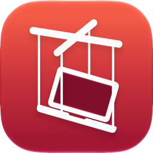

# Marionette

<p align="center">
  
</p>

Marionette is a remote desktop app for iPhone, iPad and iPhone Duo. It is built first for the Screen
Sharing server that ships with every Mac, speaking Apple's own protocol, including High Performance
mode, and works with any VNC server as a fallback.

## Features

- **Apple Screen Sharing.** Signs in with the Mac's account (SRP), encrypts the whole session, and
  supports both of the Mac's modes:
  - *High Performance*: low-latency HEVC 4:4:4 video (H.264 where the device cannot decode it), the
    Mac's sound, Retina virtual displays sized to this device or like the Mac's own, and up to two
    displays.
  - *Standard*: Full or Adaptive quality, any of the Mac's physical displays, and curtain mode.
  - Asking the signed-in user for permission, or opening a session of one's own.
- **Any VNC server**, through LibVNCClient, at Full quality or Adaptive, which lowers JPEG quality and
  then colours as the network slows.
- **SSH.** Tunnels a session over SSH, and browses, uploads and downloads the computer's files over SFTP,
  with Ed25519, ECDSA, RSA and Secure Enclave keys, and known hosts. Passwords and keys can require
  Face ID or Touch ID and be kept out of backups; keys can also go to iCloud Keychain.
- **Files and clipboard.** Sends files to a Mac and drags them in and out with Apple's native file
  transfer; shares the clipboard on request or automatically.
- **Input.** Touch or Mac-style trackpad, with magnify, rotate, smart zoom, swipe and momentum scrolling
  passed through as real trackpad gestures; a hardware keyboard, mouse, trackpad or Apple Pencil; a
  keyboard bar with modifiers and function keys; a full Mac keyboard below the fold on iPhone Duo.
- **Displays.** Fits the remote display to the device, shows a second display in its own window on
  iPad, and drives an external monitor (mirrored, external only, or both displays).
- **Discovery.** Finds Macs and SSH servers nearby with Bonjour; passwords and keys stay in the keychain.
- **Resilience.** Falls back from High Performance to Standard on a poor network and reconnects after
  interruptions.

## Building

Needs a Mac with Xcode 27.1 or later (with the iOS platform) and [XcodeGen](https://github.com/yonaskolb/XcodeGen)
(`brew install xcodegen`). The app runs on iOS and iPadOS 26 or later.

```
git clone <repository> && cd <repository>
Scripts/bootstrap.sh          # fetches the pinned dependencies, builds OpenSSL (about ten minutes), makes the Xcode project
open Marionette.xcodeproj     # choose your team under Signing & Capabilities, then run the Marionette scheme
```

The Xcode project is generated from `project.yml` and is not checked in; run `xcodegen generate` after
changing that file or adding, moving or removing a source file. To sign from the command line, pass `MARIONETTE_PROVISIONING_PROFILE=<uuid>` to
`xcodebuild` in place of `PROVISIONING_PROFILE`.

On the Mac you connect to, turn on **Screen Sharing** (System Settings › General › Sharing). Turn on
**Remote Login** as well to use SSH tunnels and file browsing.

## Documentation

- [Architecture](Docs/architecture.md): the layers, the packages and the decisions behind them.
- [Testing](Docs/testing.md): unit, UI, screenshot and live tests, `marionettectl`, continuous
  integration and releases.
- [Test machines](Docs/test-machines.md): setting up the Macs and VNC servers the live tests use.
- [Apple Screen Sharing protocol](Docs/protocol/apple-screen-sharing.md): what the app relies on, and
  how each part was verified.
- [Coding guide](Docs/coding-guide.md)
- [Contributing](CONTRIBUTING.md): what a pull request needs, and how AI assistance is attributed.

## Licence

Copyright © 2026 Turing Software, LLC.

Marionette as a whole is licensed under the [GNU General Public License, version 3 or later](LICENSE),
because it links LibVNCClient (GPL-2.0-or-later). Source that contains no GPL code, which includes
every package under `Packages/` except `SwiftVNCClient`, is licensed under the
[Apache License 2.0](LICENSE-APACHE). Each source file states its licence in an SPDX header.
Third-party work is listed in [NOTICE](NOTICE).
